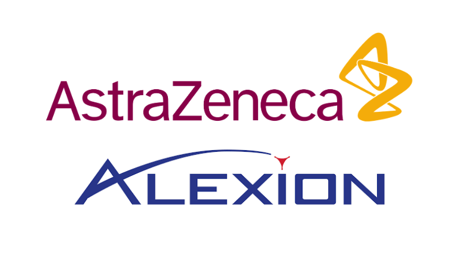

# Dis2Vec

## Project Description

Dis2Vec (Disease to Vector) is a representation learning framework that generates biologically grounded disease embeddings from human genetic and phenotypic data. This repository provides the code and implementation for the Dis2Vec framework introduced in the manuscript "Representation Learning of Human Diseases for Indication Expansion and Investment Decisions."

### Key Features

Dis2Vec addresses a fundamental challenge in translational medicine: computationally modeling complex human diseases to accelerate therapeutic development. The framework introduces a novel strategy that partitions the disease landscape into rare and non-rare categories, enabling systematic knowledge repurposing both within and between these groups.

**Core Capabilities:**

1. **Disease-Disease Association Learning (DDAL)**: Predicts therapeutic transferability using real-world drug repurposing investment decisions from clinical trials as validation benchmarks.

2. **Unsupervised Disease Clustering**: Reveals shared biological mechanisms across diseases, organizing the disease landscape into mechanistically coherent clusters that integrate rare and non-rare disorders.

3. **Cross-Evidence Generalization**: Provides biologically grounded representations validated against independent data modalities not used during training.

**Why Dis2Vec?**

- **Mechanism-Centered**: Unlike traditional knowledge graphs that rely on superficial associations, Dis2Vec learns from the hierarchical structures of Gene Ontology (GO) and Human Phenotype Ontology (HPO) to capture higher-order biological relationships.
- **Addresses Data Scarcity**: Designed to operate effectively in rare disease contexts where data is limited, making it suitable for therapeutic development across the full disease spectrum.
- **Foundation for Agentic AI**: Establishes a biologically grounded disease-representation and benchmarking layer that enables trustworthy agentic biomedical AI systems in rare-disease indication expansion.

This repository contains the implementation code, cached DDAL predictions, and notebooks for querying high-confidence disease-disease links for indication expansion and rare-to-non-rare transfer hypotheses.

## Software Requirements

Python 3.11 is recommended.

Install dependencies from `requirements.txt`:

```bash
python -m pip install -r requirements.txt
```

## Repository Structure

- **[notebooks/](notebooks/)**: Jupyter notebooks for querying predictions and visualizing disease clustering
- **[data/](data/)**: Data files downloaded from Zenodo (DDAL predictions, clustering metadata, distance matrices)
- **Dis2Vec_UPNA-DDAL/**: Core model implementation (TBD)
- **disease_definition_pipeline/**: Data preprocessing pipeline (TBD)

## How to Use This Repository

### 1. Set up Python environment

Python 3.11 is recommended (verified on 3.11.15).

```bash
python3.11 -m venv .venv
source .venv/bin/activate
pip install -r requirements.txt
```

### 2. Download data from Zenodo

Download the required data files from [https://zenodo.org/records/21253352](https://zenodo.org/records/21253352) and place them in the `data/` directory:

- `dis2vec_all_preds.parquet.gzip`
- `dis2vec_clust.xlsx`
- (Optional) `go_bp_dist_matrix.parquet.gzip` and `hpo_dist_matrix.parquet.gzip` if you plan to reproduce the MechDist network construction

### 3. Run the notebooks

**Query cached DDAL predictions:**

```bash
jupyter notebook notebooks/query_UPNA-DDAL_preds_cached.ipynb
```

Execute cells top to bottom. Update disease pair IDs in the query cells to inspect additional therapeutic transfer hypotheses.

**Visualize disease clustering:**

```bash
jupyter notebook notebooks/clustering_rare_and_common.ipynb
```

This generates interactive UMAP visualizations showing disease clusters and rare/non-rare integration.

## Methodology Overview

### MechDist Network Construction

The Dis2Vec pipeline constructs a disease-disease network (MechDist) by:

1. **Computing mechanistic similarity** between disease pairs using Lowest Common Ancestor (LCA) distance minimization within:
   - Gene Ontology (GO) Biological Processes hierarchy (for genetic associations)
   - Human Phenotype Ontology (HPO) hierarchy (for phenotypic associations)

2. **Aggregating multi-modal evidence** using CRank to handle partial data, favor top-tier consensus, and maintain network-topology awareness

3. **Filtering by similarity threshold** (0.2) to retain high-confidence disease-disease associations

### Disease Embeddings (Dis2Vec)

- **Algorithm**: Node2Vec applied to the MechDist network
- **Embedding dimension**: 128
- **Rationale**: Node2Vec captures both local (breadth-first) and distant (depth-first) neighborhood structures, enabling the model to learn higher-order biological relationships

### UPNA-DDAL Model

- **Architecture**: Two-shot learning model with a 3-layer MLP decoder
- **Training**: Transductive learning on MechDist network
- **Evaluation**: Inductive transfer learning on held-out IxIDN (positive) and ORDON (negative) benchmarks
- **Performance**: AUROC = 0.89 on cross-evidence generalization task

### Disease Coverage

Current Dis2Vec embeddings cover **4,710 diseases**:
- 4,565 rare diseases
- 145 non-rare diseases

Diseases were filtered based on data quality thresholds to ensure reliable knowledge repurposing and representation learning.

# Data

## Large Data Files

Due to file size constraints, large data files are hosted on Zenodo and are available at:

**[https://zenodo.org/records/21253352](https://zenodo.org/records/21253352)**

### Available Data Files on Zenodo (905.8 MB total)

| Filename | Size | Description |
|----------|------|-------------|
| **dis2vec_all_preds.parquet.gzip** | 244.6 MB | Compressed parquet file with all disease-disease association predictions from UPNA-DDAL model |
| **dis2vec_clust.xlsx** | 3.8 MB | Excel file with disease clustering results, metadata, UMAP coordinates, and cluster labels |
| **go_bp_dist_matrix.parquet.gzip** | 461.8 MB | Compressed distance matrix computed from Gene Ontology (GO) Biological Processes hierarchy using Lowest Common Ancestor (LCA) minimization |
| **hpo_dist_matrix.parquet.gzip** | 183.6 MB | Compressed distance matrix computed from Human Phenotype Ontology (HPO) hierarchy using LCA minimization |
| **clustering_rare_and_common.ipynb** | 1.4 MB | Jupyter notebook demonstrating unsupervised clustering and UMAP visualization of rare and non-rare diseases |
| **query_UPNA-DDAL_preds_cached.ipynb** | 35.6 KB | Jupyter notebook for querying cached DDAL predictions |
| **Dis2Vec_map_dis_vec_clust_UMAP.html** | 5.3 MB | Interactive HTML visualization of disease clustering via UMAP (colored by cluster label) |
| **Dis2Vec_map_rare_UMAP.html** | 5.3 MB | Interactive HTML visualization of disease clustering via UMAP (colored by rare vs. non-rare status) |
| **requirements.txt** | 583 Bytes | Python dependencies file |

**License:** CC BY 4.0

## Local data/ Directory

The `data/` directory in this repository should contain the key artifacts downloaded from Zenodo for use by the notebooks:

1. `dis2vec_all_preds.parquet.gzip`: cached disease-disease association predictions
2. `dis2vec_clust.xlsx`: clustering metadata used for disease ID lookup and interpretation

Download these files from the Zenodo record above and place them in the `data/` directory before running the notebooks.

# Notebooks

## notebooks/

Two main notebooks are provided (available both in this repository and on Zenodo):

### 1. `query_UPNA-DDAL_preds_cached.ipynb`

Query cached disease-disease association predictions to explore therapeutic transferability hypotheses. Example queries include:

1. **aHUS ↔ PNH**: Demonstrates shared complement dysregulation mechanisms
2. **Rheumatoid Arthritis ↔ Rare Idiopathic Inflammatory Myopathies (IIMs)**:
   - Antisynthetase Syndrome
   - Polymyositis
   - Dermatomyositis
   - Mixed Connective Tissue Disease
   - Overlap Myositis

These examples illustrate how Dis2Vec identifies both rare-to-rare and non-rare-to-rare therapeutic repurposing opportunities based on shared biological mechanisms.

### 2. `clustering_rare_and_common.ipynb`

Visualizes the unsupervised clustering results and generates interactive UMAP plots showing:

- Disease clustering colored by cluster labels (reveals mechanistic groupings)
- Disease clustering colored by rare vs. non-rare status (demonstrates integration across disease spectrum)

The notebook produces two HTML visualizations with annotations highlighting example disease groups such as Lysosomal Acid Lipase Deficiency subtypes (LALD/CESD) and Neurofibromatosis types (NF1/NF2).

# Research Context

This repository provides the code implementation for the manuscript:

**"Representation Learning of Human Diseases for Indication Expansion and Investment Decisions"**

Cyrus Babak Ravandi et al. (2026)

### Key Contributions from the Manuscript

1. **Novel Representation Learning Pipeline**: Dis2Vec constructs the MechDist (Mechanistic Distance) network by computing disease-disease similarities through Lowest Common Ancestor (LCA) minimization within GO and HPO hierarchies, then learns embeddings using Node2Vec.

2. **Rigorous Cross-Evidence Benchmarking**: 
   - **Positive controls**: Indication Expansion Investment Decision Network (IxIDN) derived from real pharmaceutical clinical trial investment decisions
   - **Negative controls**: Orphanet Rare Disease Ontology Negative-network (ORDON) based on maximally distant disease pairs

3. **Strong Benchmark Performance**: Dis2Vec-UPNA-DDAL achieved AUROC of 0.89 on the transfer learning task, outperforming contemporary GraphML models (e.g., TxGNN: 0.575) and LLM-based systems under strict cross-evidence generalization protocols.

4. **Biologically Coherent Disease Maps**: Unsupervised clustering reveals mechanistically meaningful groupings that seamlessly integrate rare and non-rare diseases, such as:
   - Parkinson's disease clustering with rare hereditary dystonias
   - Non-rare cancers co-locating with rare hereditary cancer syndromes

5. **Foundation for Translational AI**: Establishes a biologically grounded disease-representation layer that can augment agentic AI systems and knowledge graph models for rare-disease indication expansion.

# Citation

If you use this code or data, please cite:

```bibtex
@article{ravandi2026dis2vec,
  title = {Representation Learning of Human Diseases for Indication Expansion and Investment Decisions},
  author = {Ravandi, Cyrus Babak and Mowrey, William R. and Chatterjee, Ayan and 
            Khanshan, Fariba and Haddadi, Parham and Ughetto, Micha\"{e}l and 
            Barrett, Ian and Ding, Wei and Del Angel, Guillermo and Diethe, Tom and 
            Mobarec, Juan Carlos and Lambden, Simon and Cheng, Seng and 
            Eliassi-Rad, Tina and Risa, Gabriel and Ricchiuto, Piero},
  year = {2026},
  journal = {In Preparation},
  note = {Code: \url{https://github.com/alxndgb/Dis2Vec}, 
          Data: \url{https://zenodo.org/records/21253352}}
}
```

## Related Resources

- **Code Repository**: [https://github.com/alxndgb/Dis2Vec](https://github.com/alxndgb/Dis2Vec)
- **Data & Notebooks**: [https://zenodo.org/records/21253352](https://zenodo.org/records/21253352)
- **Manuscript**: In Preparation (2026)

## Contact

For questions or collaborations, please contact:

- Cyrus Babak Ravandi: Cyrus.Ravandi@Alexion.com
- Gabriel Risa: Gabriel.Risa@Alexion.com

## Acknowledgments

The authors acknowledge AstraZeneca's Scientific Computing Platform (SCP) for providing the computational infrastructure and resources that enabled this research.

## License

The code in this repository is provided for research and educational purposes. Data files on Zenodo are licensed under CC BY 4.0.

## Affiliations

This work was conducted by researchers at:
- Alexion AstraZeneca Rare Disease, R&D, Boston, USA
- Network Science Institute, Northeastern University, Boston, USA
- Additional collaborating institutions (see manuscript for full list)


